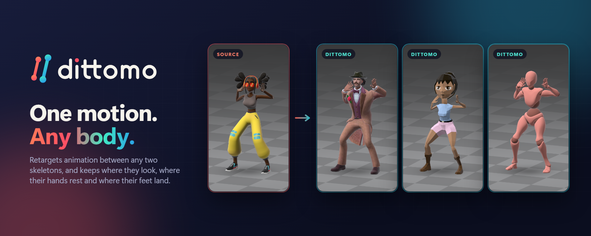
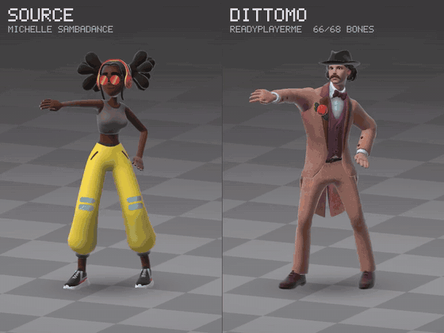
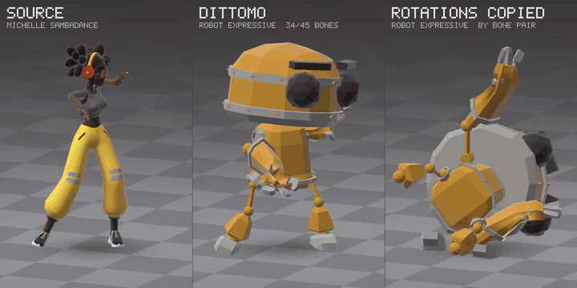
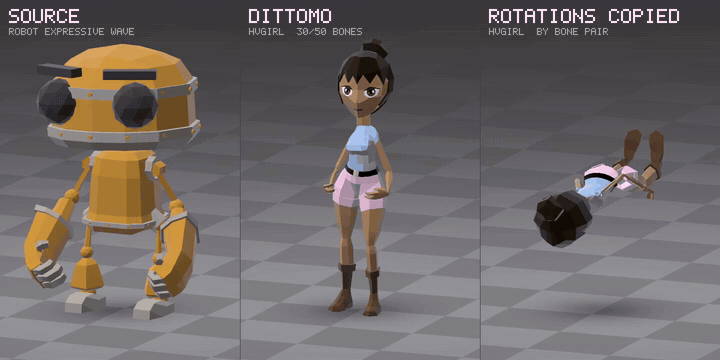
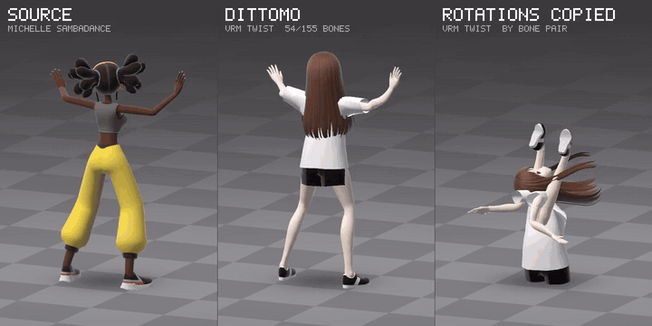
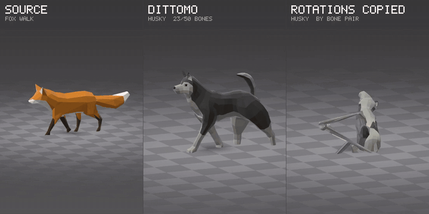

<p align="center"></p>

# dittomo

**One motion. Any body.** dittomo retargets an animation from one skeleton onto any other. The more alike the two rigs,
the closer the copy, and a rig onto itself plays its clip unchanged. It keeps what makes a performance read as the same:
where the character looks, where its hands rest on its body, and where its feet land.

<p align="center"></p>

Pure Rust, no `unsafe`, deterministic, MIT-0. Its only dependency is [glam](https://crates.io/crates/glam); reading
and writing model files adds [polysmelt](https://github.com/Azazel-Labs/polysmelt), behind a feature. To retarget files
without writing code, `cargo install dittomo --features fs` installs a `dittomo` command (see Writing clips), or
[the browser demo](https://azazel-labs.github.io/dittomo/) does it with nothing installed and nothing uploaded.

```rust
use dittomo::{Clip, Fixes, Mapping, Skeleton};

fn play_on(source: &Skeleton, target: &Skeleton, clip: &Clip) -> Result<Clip, dittomo::Error> {
    let map = Mapping::new(source, target);
    println!("{:.0}% alike", map.quality() * 100.0);
    map.apply_with(source, target, clip, Fixes::ALL)
}
```

`apply` is the plain retarget; `apply_with` adds the contact fixes below, and `apply_touching` also keeps hands on the
body, given both rigs' skins. For a game loop, `Player` poses one frame at a time without allocating, and `Crowd` poses
many characters through one player at once, eight side by side, in about half the time each.

For poses that arrive one at a time, with nothing ahead to look at (motion capture streaming in, a networked player,
another animation system's output), `Live` plays each and makes the same fixes from the poses so far, also without
allocating:

```rust
use dittomo::{Fixes, Live, Mapping, Skeleton, Transform};

fn stream(source: &Skeleton, target: &Skeleton, poses: impl Iterator<Item = (f32, Vec<Transform>)>) {
    let map = Mapping::new(source, target);
    let mut live = Live::new(&map, source, target, Fixes::ALL).unwrap();
    let mut out = target.rest();
    for (dt, pose) in poses {
        live.pose(dt, &pose, &mut out).unwrap();
        // draw `out`
    }
}
```

Arms kept out of the body and hands together come out just as the whole clip's do; hands go on the head as the whole
clip's do, but are eased on as the source's get there, not ahead. Feet plant as soon as the source's are down and nearly
still, held where they were shown the pose before so they don't slide as they settle; a clip walked in place is planted
on the travel its feet imply, then kept in place. `Live::touching`, given both rigs' skins, keeps hands at the skin's
distance too, just as the whole clip does. `Live::delayed(6)` plays each pose six poses late, a fifth of a second at 30
a second, and plants feet with those six in sight as the whole clip does: eased in before they land, held where they
stand on average.

The videos are rendered by `examples/video.rs`: the source, dittomo's copy, and the same clip with each bone's rotation
copied by name, side by side, skinned and drawn on the CPU and piped to `ffmpeg`.

```sh
cargo run --release --features fs --example video -- source.glb target.vrm out.mp4 [--clip NAME] [--seconds S]
```

`--start S` begins that far into the clip, and `--against none` puts dittomo with its fixes off in the third panel
instead of the copied rotations.

## Hard cases

Each against the same clip with its rotations copied bone by bone, which is what a retarget without dittomo's matching
gives.

<p align="center"></p>

A human's samba on a cartoon robot: a head as wide as its body, no collarbones, short legs and feet hung from the root
for IK. dittomo pairs 34 of its 45 bones, plays the feet as the ends of the legs, and keeps the arms clear of the body
and head.

<p align="center"></p>

The other way: the robot's wave, made for its long arms and hunched rest pose, on a human. The robot's bones point
other ways at rest, so copying its rotations lays her flat; dittomo plays each bone's turn from rest, and she waves.

<p align="center"></p>

The samba on a VRoid avatar of 155 bones, 54 of them paired: hair and shirt bones for physics, twist bones, and sleeves
hung from helpers beside the upper arms, which turn with the arms rather than staying out in a T-pose.

## Results

### Finding the right bones on real rigs

Seventeen real characters, fetched at pinned commits by `sh bench/rigs/fetch.sh`: Mixamo's Xbot, Michelle, Soldier and
Samba Dancing (one as FBX), Ready Player Me, three.js's RobotExpressive, Khronos's CesiumMan, RiggedFigure and
BrainStem, two VRM avatars, Babylon's HVGirl, Mesh2Motion's human, from Godot's demo projects the platformer's robot and
GDQuest's Mannequiny, BoQsc's base mesh on a Rigify metarig, and a CMU motion capture take as BVH. Each rig's body
joints are labeled by hand (`bench/rigs/labels.txt`); every one of the 272 ordered pairs is mapped, and a joint counts
as found when the target's joint plays the source's. Godot's humanoid auto mapping (its `BoneMapper`, ported faithfully
from the editor's source into `benches/rigs/godot.rs`, MIT) maps both rigs onto its humanoid profile, as a `BoneMap`
does, so it gets a joint when both rigs' bones get the same profile bone. `cargo bench --features fs --bench rigs`:

| Matcher | Joints found (5328) |
| --- | ---: |
| dittomo | 100.0% |
| Godot's humanoid auto mapping (`BoneMapper`) | 63.2% |
| Exact name, ignoring case and namespace (three.js `SkeletonUtils.retarget`, Babylon) | 22.2% |

| Joint | dittomo | Godot | By name | | Joint | dittomo | Godot | By name |
| --- | ---: | ---: | ---: | --- | --- | ---: | ---: | ---: |
| hips | 100% | 76% | 24% | | thighs | 100% | 49% | 18% |
| spine | 100% | 77% | 24% | | shins | 100% | 49% | 17% |
| chest | 100% | 40% | 12% | | feet | 100% | 55% | 21% |
| neck | 100% | 88% | 31% | | toes | 100% | 63% | 22% |
| head | 100% | 88% | 40% | | clavicles | 100% | 100% | 31% |
| upper arms | 100% | 57% | 17% | | forearms | 100% | 57% | 17% |
| hands | 100% | 73% | 26% | | index fingers | 100% | 59% | 28% |

What it got wrong, and what fixed it:

- **BrainStem**, named `node0`…`node21`, with one arm stopping short of the hand and no collarbones: 92% to 100% against
  the other rigs, its arms and legs all found. Its head is one bone with nothing beyond it, hung from the chest with no
  neck, and had been taken for another rig's neck, or for the end bone atop its head: up from the chest the head is the
  last bone, however many the neck has, and a neck of as many bones as the other's is matched bone for bone, however
  long each. That took heads from 92% to 96%, and the Rigify base mesh, whose head is a short bone atop a short neck,
  from 88% to 100% against RobotExpressive, whose head's root is its highest joint. Against seed-san, whose chest also
  holds a bag on its back, at the middle but lower than the shoulders, it went from 93% to 100% once the neck was looked
  for only from the shoulders' height up, at the middle between them rather than the root's (hvgirl's middle stands off
  its root's). Its upper arms start where a collarbone ends, a third of its height out from the middle, and had been
  taken for RobotExpressive's shoulders, a stub as far out from the chest; told apart by where each goes on to, against
  the robot went from 60% to 90%.
- **Godot's platformer robot** is named for its viewer's left and right, not its own: its `r-` limbs are on its left.
  Names would swap every limb, so where both of a two-legged body's knees bend clearly the other way from where its
  names put its front, dittomo takes its sides from the knees: against the other rigs it went from 15%–33% of joints
  found to 67%–100%, and clips played onto it from 19°–49° of limb error to 0.4°–8°. Its arms stop at the elbow, with no
  hand, so a limb of two bones is measured to where its hand would be, a forearm past the elbow. Its head hangs from a
  tracker standing where it does, with a vent atop it reaching higher than any head's root: up from the chest, of a bone
  and a child standing where it does the child is taken, and nothing more than 1.4 times as high as the shoulders is,
  which took heads from 96% to 98%. With no hand to find it by, its chest is the lowest bone above the hips with chains
  reaching well out on both sides, so its neck and head play the source's rest to rest: against Rigify's and BrainStem's
  heads, which end at the head's root, its head had looked 13°–30° away from where theirs did, and now looks the same
  way. Up a neck of as many bones as the other's, each plays the one as many bones up, however big the head, and the
  vent on its head, beyond it, is not a head, which took necks and heads to 100%. A control hung far from every other
  bone, as a target well ahead of the head for it to look at, is left out of where the body's middle is. Against
  CesiumMan and RiggedFigure it had found 73% to 87%: its shoulders stand wide and high, well out from a chest bone low
  in its body, so the way out to them was as long as their upper arms, and an arm was taken one bone along. An arm turns
  at the shoulder and the elbow wherever they stand, so each is picked from the arm's spans, as the arms' reach picks
  them (spine to shoulder, shoulder to elbow, elbow to hand, all long), and an arm of two bones bends between them:
  shoulders play shoulders and elbows elbows, which took both to 100% and every rig's arms with them.
- With names to go by, the misses had mostly been one bone along a chain, a spine of one bone taken for the second of a
  rig's two. Up from the hips, the spine is the first bone, however many lie between the hips and the chest, not
  counting one no higher than the hips (RobotExpressive's `Hips` hang below `Body`, the bone its legs hang from), and a
  spine of as many bones as the other's is matched bone for bone. That took spines from 88% to 98%. CesiumMan's and
  RiggedFigure's `torso_joint_2` had been taken for the Rigify base mesh's `spine.002` by its number and height; placed
  by how many bones up from the hips to the chest it stands rather than how high, every spine is found.
- **The CMU take**, as BVH, starts every branch with a joint where its parent's is: a lower back at the hips, a neck at
  the chest, hip joints at the hips and collarbones at the chest, none of them mirrored by where they stand. Its sides
  are taken from where each limb's chain goes, its pairs measured where their chains leave the parent, and its neck
  looked for past a bone standing where the chest does; a bone standing where its parent does, beside others with bones
  beyond it, is a second joint at that point, not the next one along. Against the other rigs it went from 68%–95% of
  joints found to 100%.
- Godot's mapper looks for words in names and walks down from what it finds, so a rig it can't start on loses everything
  below: BrainStem's unnamed bones get nothing; CesiumMan's hips are taken for its `torso_joint_3`, the chest, and its
  arms and legs aren't found; RiggedFigure has no bone named foot or hand, so only its trunk is; RobotExpressive's feet
  hang from the root, and its hand is taken for the palm bone of its middle finger.

CI runs this on every push and fails below 99% of joints found or above 3° of limb error. The rigs are fetched rather
than committed; each keeps its own license. Unity's Avatar and Unreal's IK Retargeter aren't in the table: their
matchers aren't open source, and need the engine running.

### Playing real clips

The same rigs' own 54 clips (Mixamo's 14 dances, walks, runs and gestures, RobotExpressive's 14, Mannequiny's 10, the
platformer robot's 8, CesiumMan's and RiggedFigure's walks, BrainStem's 35-second take, HVGirl's four and the CMU take)
played on every other rig: 864 clip and rig pairs. Each labeled limb segment, shoulder to elbow and so on, is compared
with the source's direction frame by frame, each in its own body's frame. A foot is judged by where it points, the way
it points across the floor at rest turned as it has turned from rest: every rig stands flat at rest, and how steeply an
ankle comes down to the toes is anatomy. The trunk, hips to chest and chest to head, is judged by how it leans, tilted
as it has tilted from rest, as every rig stands upright at rest; a collarbone the same way, straight out to its side
tilted as it has tilted, as how one slopes up or back to the shoulder is anatomy too. The other rows are what a clip
gets without a retargeter, even given the right bones: an engine's animation mixer plays a clip on another rig by
copying each bone's local rotation, and a hand-written script commonly copies each bone's turn from rest in the world.

| Retarget | Mean | Median | 90th percentile | Within 15° |
| --- | ---: | ---: | ---: | ---: |
| dittomo | 1.7° | 0.2° | 5.0° | 98% |
| dittomo, with the joints it misses set by hand (`Mapping::set`) | 1.7° | 0.2° | 5.0° | 98% |
| World turns from rest copied onto the right bones | 13.8° | 5.4° | 46.3° | 76% |
| Local rotations copied onto the right bones | 75.8° | 85.3° | 153.3° | 19% |

What's left is mostly proportions: a two-bone stretch (hips to chest, hand to index finger) can't point the same way on
both rigs when the bones between are in other ratios. The collarbones are off by 6° as world turns copied are, by twist:
a source collarbone turning about its own length doesn't move its shoulder, but the same turn moves the shoulder of one
built at another slope. Keeping only the swing lowers that here, but it was further from SAN's clips below (0.72 against
0.66 across skeletons), so dittomo keeps the whole turn. dittomo finds every labeled bone, so setting them by hand
changes nothing. CI fails if the mean passes 3°.

Where the character looks is judged apart: the way the head faces, against the source's, each in its own body's frame.
It's off by under 0.05° on average (local rotations copied: 65.2°). It was 11.8° when the neck and head took their
source's turns as they are, which tips the face of a rig whose head bone isn't built facing forward. They now keep the
target's own rest look and take only the turn away from it, as the spine below them does.

The same pairs again, with each contact fix alone and all together, over the 40,410 frames where a source foot is
planted (within 5% of its height of the lowest it gets, moving under a tenth of its height a second), of each clip's
first 300 frames. A clip whose foot never comes within a tenth of the height of where it stands at rest, as the robot's
fall, plants nothing, as dittomo itself judges it. Slide is how far the target's foot moves each such frame; sole height
off is how far its sole is from where the source's is, scaled; both are over the target's height. The sole is whichever
of the foot and toe joints is lowest against the source's, each counted from where it stands at rest: a flat foot stands
on its ankle's height and one rolled onto its toes on its toes'. Clips walked in place are judged on the travel their
feet imply. Pops count how often a fix jerks a joint: of the frames of every joint both rigs label, the share where the
joint, about the hips, is further from where it would be moving steadily from the frame before to the one after than the
source's is, by over 1% of the height.

| Fixes | Foot slide | Sole height off | Limb directions, mean | Pops |
| --- | ---: | ---: | ---: | ---: |
| none (`apply`) | 0.00476 | 0.0106 | 1.9° | 0.20% |
| travel | 0.00123 | 0.0106 | 1.9° | 0.20% |
| planted feet | 0.00347 | 0.0001 | 2.6° | 0.29% |
| push-out | 0.00476 | 0.0106 | 1.9° | 0.20% |
| all (`apply_with`) | 0.00002 | 0.0001 | 2.8° | 0.35% |
| all, live (`Live`) | 0.00008 | 0.0001 | 3.0° | 0.42% |
| all, live, 6 poses late (`Live::delayed`) | 0.00009 | 0.0001 | 2.8° | 0.39% |

Together they cut foot slide hundreds of times and the height error a hundred. The body travels across the floor by how
high each rig's legs start, as far as they step, not by how high its hips bone stands: the Godot robot's hips bone sits
below where its short legs start, so on the rigged figure the body went a fifth further each step than the figure's legs
stepped, and late in each stance the held foot was out of reach and dragged along. Up and down it still goes by how high
the hips stand. That took the slide with travel alone from 0.00143 to 0.00123 and the pops with every fix from 0.45% to
0.41%. It costs a little against SAN's Mixamo clips below, whose truth scales the hips' path by how high they stand. The
degree they cost is the legs bending to keep feet down where the target's stride and leg proportions differ from the
source's. Where a planted foot is further below the hip than the target's leg reaches, bent as it was played, the body
is lowered, eased in and out, rather than the knee snapped straight: that took the height error from 0.0015 to 0.0001.
The body is lowered a tenth of the leg at most, and never so far that a bone but the feet goes under the floor. Where a
planted foot is played under the floor instead, the body is raised to hold it there bent as it was played, rather than
the knee bent further, as far as every foot held still reaches a little short of straight: a target standing with its
knees bent at rest, its legs straightening as far as a source's standing straight, reaches further down than its hips
come up. On a walk played on such a rig that took the planted knees from 12° off as played to 0.5° (1.2° live), and
the limbs here from 2.9° to 2.8° (3.1° to 3.0° live, 3.0° to 2.8° six poses late), for a few more pops live (0.41% to
0.42%). Against SAN's clips below, whose truth leaves the feet where Mixamo plays them, planted feet went
from 1.42 to 1.47. A foot
let go, or about to plant, is moved as it is played, and as far again as the hold moves it at that end, eased out,
rather than eased from the hold toward where it is played: that lagged behind a foot swinging off and jerked the leg,
and cut the pops from 0.50% to 0.17%. A contact split where the source's foot slips holds the foot where the part before
did, moved on as far as it slips as played, rather than each part at its own average: a foot drifting as it is played
jumped from one to the next. Played live, with nothing ahead, slide is cut nearly seventy times: a foot is held from the
pose it lands, where the target's was the pose before, so it doesn't slide as the legs settle unlike the source's,
though the knee bends a little more to hold it. The body is lowered there too, at once as far as the legs need, then
eased back up over a tenth of a second. Six poses late slide is cut fifty times, with limbs closer and nearly as few
pops as the whole clip's. A foot coming down for the first time well above the floor the other found, but within a tenth
of the height of it, has come down to its own ground once it stops coming down, not only once it has lifted from there:
Mannequiny's run plants one foot 6% of its height higher than the other, and played live slid that foot's first step, a
run of 15 frames, a twelfth of the height a frame. That halved the slide left live. Once the floor is known, a foot
isn't taken to stand on where it was at the first pose if that is over a tenth of the height above the floor: the
robot's walk starts with a foot swinging, and planted it in the air as it swung back past there, which took the slide
left live from 0.00016 to 0.00012. Live travel stops growing once the source's hips have wandered a fifth of its height
from where they began, as far as the whole clip's travel lets them, not a tenth: Mannequiny's kick leans its hips that
far into the kick, and played live its travel stopped at the kick's height and its feet slid on landing. Letting it go
on took the slide left live from 0.00011 to 0.00007 and six poses late from 0.00012 to 0.00009. A foot is planted from
the first pose it stands on, judged by how fast it comes or goes, whichever is slower, so clips keyed in steps, whose
feet jump between held poses, keep their feet still too. Push-out finds nothing to do here, as none of these clips put a
hand through the body.

Hands on the body, over the 96 pairs where both rigs have a skinned mesh: 16,392 hand frames, 6,360 of them with the
source's hand within 3% of its height of its own skin. The gap is how far the hand is out from the skin nearest it, over
each body's height; the target's should match the source's.

| Fixes | Hand gap off, source hand near: mean | 90th percentile | Target hand inside its body, source's not |
| --- | ---: | ---: | ---: |
| all but touch (`apply_with`) | 0.0304 | 0.0648 | 5.1% |
| all (`apply_touching`) | 0.0081 | 0.0179 | 0.3% |
| all, live (`Live::touching`) | 0.0081 | 0.0179 | 0.3% |

So a hand resting on Michelle's hip rests on the coat of a stockier body instead of sinking into it: the gap is matched
3.7 times closer and hands end up inside the body an eighteenth as often.

### Against the learned retargeters

[SAN](https://arxiv.org/abs/2005.05732) ([code](https://github.com/DeepMotionEditing/deep-motion-editing), SIGGRAPH
2020) set the Mixamo test most learned retargeters report on: 106 clips played from each of four characters onto the
others with the same skeleton (intra-structural), and from BigVegas, whose skeleton adds a pelvis hub, hair, a cape and
a facial joint, onto all four (cross-structural). The error is the mean squared distance of each joint from the clip
Mixamo itself made for the target, over the target's height squared, ×10³. `sh bench/san/fetch.sh` downloads SAN's test
set; `cargo bench --bench san` scores it with SAN's own formula.

| Method | Trained | Intra | Cross |
| --- | :---: | ---: | ---: |
| NKN (CVPR 2018), from SAN's table | yes | 6.24 | 243 |
| PMnet (BMVC 2019), from SAN's table | yes | 5.72 | – |
| CycleGAN-style, from SAN's table | yes | 7.66 | 8.97 |
| SAN, from SAN's table | yes | 2.76 | 2.25 |
| **dittomo** (`apply`, no fixes) | no | **1.44** | **0.67** |
| Local rotations copied by bone name, root moved as the source's | no | 43.0 | 24.9 |
| Local rotations copied by bone name, root scaled by hips height | no | 1.37 | 0.70 |

dittomo finds the bones itself, needs no training, and beats SAN on both. Three caveats:

- Copying local rotations by name and scaling the root does better within one skeleton (1.37 against 1.44), because
  Mixamo makes these clips by copying rotations onto each character and then adjusting its legs; per joint, the copy is
  exact above the hips. [R2ET](https://arxiv.org/abs/2303.08658) ([code](https://github.com/Kebii/R2ET), CVPR 2023) says
  the same of its own table, where copying beats every learned method on position error. This test rewards doing what
  Mixamo does more than looking right. The copy works only because all five skeletons share Mixamo's names, rest axes
  and T-pose; on the real rigs above it is off by 74.0°.
- SAN's paper gives 8.86 for its copy baseline; unscaled, these runs get 43.0, mostly from Mousey being about half
  BigVegas's height. The scaled copy is the fair baseline.
- The travel fix, which adds the travel an in-place clip's feet imply, does harm here (8.1 and 14.2): Mixamo's in-place
  dances, like "Dancing Running Man", are meant to stay put. It is off by default for that reason.

### Speed

On one core of an Intel Core Ultra 7 155H, Rust 1.100, `cargo bench --bench retarget`, best of several runs:

| Case | Time |
| --- | ---: |
| Map a 65-bone Mixamo-layout rig onto itself | 0.5 ms |
| Map it onto a 76-bone game-engine mannequin (five-bone spine, twist bones, A-pose, other bone axes) | 0.9 ms |
| Play a clip, mixamo → mannequin, setup included | 2.5 µs per frame |
| Pose one frame with a reused `Player` | 1.3 µs per frame |
| A walk with every fix on: travel, planted feet, push-out | 3.3 µs per frame |
| The same walk done in place, travel worked out from the feet | 3.3 µs per frame |
| Set up a `Player` for a pair of rigs | 40 µs |

Mapping's times are scaled from runs back to back with the earlier, slower mapping, which took 1.1 and 2.3 ms here.
On a busier run, where the walk with every fix took 4.5 µs a frame, `Live` played the same walk with every fix but touch
in 3.1 µs a frame, the walk done in place in 3.0 µs (the whole clip: 4.9 µs), and the walk six poses late in 3.4 µs.
Where a reused `Player` posed a frame in 1.8 µs, a `Crowd` of 64 characters posed each in 0.89 µs. Keeping hands at the
skin's distance as well, with skins of 5,570 and 6,697 points, takes about 3.8 times as long as the live walk without
it: 7.6 µs against 2.0 µs, the fastest of runs back to back with the earlier code, which took 10.1 µs. The skin's balls
round each bone are placed once a pose, not once a hand, and a hand's reach toward the skin is measured in each bone's
own frame, so only its points that could reach farthest are looked at.

three.js plays the same clip on the same rigs in `bench/three`, given dittomo's bone pairs as its names so only playing
is timed. Measured back to back with dittomo on one machine (three.js r187 on Node 26):

| Play a 60-frame walk, mixamo 65 → mannequin 76 | dittomo | three.js `SkeletonUtils` | |
| --- | ---: | ---: | ---: |
| Whole clip, setup included (`apply`, `retargetClip`) | 3.6 µs per frame | 221 µs per frame | 61× |
| One frame, rigs reused (`Player::pose`, `retarget`) | 2.5 µs per frame | 186 µs per frame | 74× |

three.js does less for that time: it copies each bone's world rotation as it is, with no correction for rests that
differ unless offsets are given by hand, and finds each bone's pair by name on every frame.

Babylon.js's `AnimatorAvatar.retargetAnimationGroup` (9.34, in `bench/babylon`) is closer. It corrects for rests that
differ, carrying each key's turn from the source bone's rest into the target's, and bakes a whole clip, with no call
to pose one frame. Measured back to back on a busy machine, best of five runs each: dittomo played a frame in 7.0 µs,
Babylon in 50 µs (7×), and in 143 µs with the hips' path scaled to the target (20×), which it does by playing both
clips through again key by key. three.js took 327 µs on the same runs. CI runs all three on every push.

Foot skate per planted frame, over the character's height, on a 90-frame walk:

| Target | Plain | Feet planted |
| --- | ---: | ---: |
| Same rig with 30% longer shins and feet | 0.00027 | 0.00001 |
| Mannequin | 0.00050 | under 0.00001 |

Timings and foot skate are measured on made-up rigs that copy the real ones' layouts (see Tested on). CI benchmarks
every pull request against its base on the same runner and fails it if anything gets more than 25% slower.

## Reading models

With the `load` feature, `dittomo::load::Model` reads a skeleton and its clips from glTF, GLB (VRM avatars too), FBX or
BVH bytes (`Model::from_bytes(bytes, "fbx")`), FBX read directly with no Blender round trip and BVH motion capture (the
CMU database's, say) with no conversion. `fs` adds `Model::load(path)`, and `usd` adds USD. Each skin's joints, and the
nodes above them, become the skeleton; each animation is sampled at its keys into a `Clip`. `load` builds for wasm. The
first twelve benchmark rigs and their 35 clips read in about 0.27 s together on one core of a laptop. The eleven glTF
and VRM rigs take 90 ms between them (the biggest, seed-san's 132 bones, 16 ms; hvgirl's 1,295 frames over 147 channels,
10 ms); the rest is the 3.7 MB Mixamo FBX, whose dance keys each curve every 1/480 s at times of its own, 10,849 poses
in all, each one kept.

## Writing clips

`Model::write_clip` adds a clip to the document the model was read from as a glTF animation, and polysmelt writes the
document as a GLB, so a retargeted clip goes out with the target's meshes, materials and VRM extensions as they were.
`load::document(path)` reads the document (`load::document_from_bytes` one in memory) and `Model::from_document` the
model from it:

```rust
let source = Model::load("walk.fbx".as_ref())?;
let mut doc = load::document("avatar.vrm".as_ref())?;
let target = Model::from_document(&doc)?;
let mapping = Mapping::new(&source.skeleton, &target.skeleton);
let skins = [&source.skin, &target.skin];
let walk = mapping.apply_touching(&source.skeleton, &target.skeleton, skins, &source.clips[0].1, Fixes::ALL)?;
target.write_clip(&mut doc, Some("walk"), &walk)?;
std::fs::write("avatar_walk.glb", doc.to_glb()?)?;
```

Each bone is keyed only where it moves, and only at the poses that playing linearly between the others doesn't give
within a thousandth of a degree, or a hundred-thousandth of the body's height. A node placed by a matrix is placed by
its translation, rotation and scale instead, as glTF animates only those. Played back, no joint comes further than a
millionth of the body's height from the clip on Michelle's samba played on the soldier, or 0.00005 on the Mixamo samba's
FBX played on seed-san, whose 10,849 poses (its curves are keyed at times of their own) come down to under two fifths as
many keys.

With `fs`, the `dittomo` command does it file to file, playing every clip of the source (or those named) on the target
with every fix, and writing the target with them in place of its own:

```sh
dittomo walk.fbx avatar.vrm avatar_walk.glb [--clip NAME|N]... [--fixes all|none] [--keep] [--pairs]
dittomo walk.fbx avatar.vrm avatar_walk.bvh [--clip NAME|N]... [--fixes all|none] [--fps N]
```

`--keep` keeps the target's own clips too, and `--pairs` prints which source bone each target bone follows. The FBX
samba onto seed-san's 132 bones takes 0.8 s, reading and writing included; Michelle's samba onto the soldier 0.08 s.

An output ending in .bvh gets the target's skeleton and the clip as BVH motion capture instead, for MotionBuilder,
Blender, Maya and the other tools that take mocap (`dittomo::bvh::write`, with no features needed). The hierarchy is the
target's rest pose with every joint's axes lined up with the world's, so the file's rest pose is the character's own T-
or A-pose whatever axes its bones had; each frame turns each joint from there, in Z, X, Y order, kept near the last
frame's angles so none flips by a full turn. BVH frames are evenly spaced, so a clip whose times aren't is sampled, at
its own middle spacing (no finer than 120 a second) or `--fps`. Blender 5.2 reads the samba written for seed-san back
with every bone where dittomo puts it, and writing its 2,185 frames of 132 bones (4 MB) takes 80 ms. With more than one
clip, each goes to a file of its own.

## Contact fixes

`Fixes` turns each on or off; all but travel are on by default. None of them need bone names: legs and arms are found
from the rest pose alone (`contact::legs`, `contact::arms`). The spine runs from the biggest root to the highest bone. A
leg ends in a bone near the floor on a chain hanging from the spine; an arm ends at the first bone whose children split
the chain evenly, as fingers do. The knee or elbow is the joint along the chain standing farthest from both the spine
and the end, and the hip or shoulder the one above it farthest from both, so twist bones, sleeves and helpers along the
way don't count. The arms are the chains off the one spine bone whose chains end in the most bones, so hair, capes and
tails are left out, and fingers hanging low aren't taken for feet.

- **Travel.** A clip walked in place gets the travel its planted feet imply. A clip that already travels is left alone.
  Off by default, as a clip made for a game that moves the character itself should stay in place: its feet are still
  planted on the travel they imply, then the travel is taken off again, so the legs are posed as they'd be walking and
  the body stays where the source's is.
- **Planted feet.** Where the source's foot is planted, the target's is held where it lands, as high over where it
  stands at rest as the source's is over its own, scaled to the target, or higher if a toe would otherwise come lower
  than the source's does: ankles stand higher over the toes on some rigs than others, so a foot rolled onto its toes
  needs its ankle lifted more or less than the source's to keep them on the floor. Nor does it come further under the
  floor than the source's comes under its own: the Quaternius horse stands at rest with its hooves well above its root
  and walks with them on the root's level, and a paw brought down as far from where it stands went through the floor.
  Two-bone IK (`contact::reach`) bends the knee and swings the hip to put it there, keeping the foot's turn, easing in
  and out over about a tenth of a second. Where the leg would have to straighten past how bent it was played, or past
  nearly straight, to reach, the body is lowered over it instead, eased over the same time; where the foot is played
  under the floor, the body is raised for the leg to reach it bent as it was played, as far as every planted leg still
  reaches.
- **Push-out.** Spheres along the spine and one round the head stand for the body; elbows, hands and forearms inside
  them are turned out, the upper arm first, then the forearm. Short arms raised overhead go round the head, not
  through it.
- **Hands together.** Where the source's wrists meet (a clap overhead in jumping jacks, a clasp, hands pressed in
  prayer), the target's are brought together at a point both its arms reach, outside the body and the head, keeping
  the hands' turn and the gap between them the source has, scaled. Arms too short to meet where the source's did meet
  lower, arms too long meet without crossing; the meeting point is searched for round each sphere in the way, and kept
  near the last frame's so the hands don't jump. They let go smoothly as the source's hands part.
- **Hands on head.** Where the source's hand is on its head (covering the ears, clasped on top, a palm to the forehead),
  the target's goes to the same place on its own head: the way from the middle of the head to the wrist is taken in
  the head's frame and scaled from one head to the other, so a cartoon's big head gets hands spread wider and the hands
  follow as the head turns. The head's size comes from its skin with `apply_touching`, else from the bone at its top,
  where there is one. A hand that can't get there (short arms on a big head) goes as near as it can over the head's
  surface, not into it, and the elbow swings round the line from shoulder to hand till the arm is no deeper in the head
  than the source's, swinging round only as far as it is eased on. A hand darting to the head is eased on over a
  quarter of a second, ahead of the source's, moving a share of the way to where it lands so it arrives along its own
  path; one sweeping past the head is left alone, as is one with its wrist over half its forearm's length off the
  head's surface: a cartoon's head is so big that a hand raised beside it, well clear, is within two of its radii.
- **Touch** (`Mapping::apply_touching`, given each rig's `Surface`; `load::Model` reads it as `skin` from the skinned
  mesh). Each skin is thinned to points about 1/80 of the height apart, each bound to the bone that moves it most;
  a face wider than that, all of it moving with one bone (a box for a head), is filled in between its corners.
  Every frame, the gap from each hand to the skin of the rest of the body (arms left out) is measured on the source
  and on the target, along the skin's smoothed outward facing; a hand off to the side of the skin nearest it, past
  its edge (a sleeve left open where the arm is cut off), is out from that edge instead. Where the source's hand is
  near its body, two-bone IK moves the target's hand to the same gap over its own height, keeping its turn, and lets
  go smoothly as the source's hand moves away; a hand anywhere in the body, however deep, is brought out of it.

## How it maps

Nothing is assumed about what the skeletons are: humans, quadrupeds, birds and tails all go through the same matcher.
Every source bone is compared with every target bone on:

- **Names.** Spellings from Mixamo, Unreal, Unity, Rigify, Character Creator, Daz, 3ds Max Biped and Blender's numbered
  copies are brought together: `mixamorig:LeftUpLeg`, `thigh_l`, `DEF-thigh.L` and `LeftUpperLeg` all read as the left
  thigh. Sides (`L`, `_r`, `Left`) and numbers (`Spine2`, `spine_03`) count. Bones named `Bone.004` simply say nothing.
- **Shape at rest**, measured in the body's own frame and over its height, so size, units and facing don't matter:
  - which way the bone points from its parent and to its biggest child
  - how high it stands
  - how long it is and how much body lies beyond it
  - which side it's on
  - counting for less as proportions differ, where it is and how far along the body
  - and, counting for more as they differ, how far along the arm it is, from the chest to where the hand begins: a
    cartoon's arms may be twice a man's for its height, with its shoulder where his elbow would be.

The body's frame is found from the plane its bones are most nearly mirrored in, turned towards the bones named left or,
failing names, the way its feet point. Two bones are mirror images when they hang from one bone, as high as each other,
on either side of it, and, if named, are named as the same part for opposite sides; both may hang ahead of that bone, as
an animal's front legs hang ahead of the spine bone they're tied to, when they point away from where they lie (fingers
point the way they lie). The two biggest such pairs that are long enough to be limbs, and don't rise to their ends as
ears and antlers do, are the arms and the legs, or the front and hind legs: the arms being the pair farther along the
bones from the root.

The two trees are then matched as wholes for the most total likeness, keeping the family. A bone below another plays a
bone below the other's, and separate limbs play separate limbs. Any bone on either side can be passed over, so a root
above the hips, twist helpers, a five-bone spine against a three-bone one, fingers or a tail don't throw off the rest.
This is the constrained tree mapping of Zhang (1996), with subtrees paired by the Hungarian method.
Bones left out are then paired where the family allows, as five fingers into a palm bone holding two, and a bone
with nothing under it may play one whose children play its siblings: a head beside the ears against one above them.

`Mapping::quality` says how much of the target is played and how alike, from 0 to 1. `Mapping::set` corrects a bone
the match got wrong.

## How it plays

Each mapped bone takes its source bone's turn away from rest, in the world. That turn is first carried into the
target's frame and corrected for the two rest poses: at rest, the source bone and the next mapped bones below it point
one way, and the target's point another, and the turn that best lines up all of them at once is undone. All of them,
not the one with most below it: one rig's collarbones start above its chest and another's beside it, and lining up
either alone would tip the chest. So the target's bones point where the source's do, frame by frame, whatever each
rig's rest pose (A-pose or T-pose) or bone axes. The spine, neck and head, and the feet and toes, are matched rest to
rest instead (the feet turned about the vertical to point the same way), as every rig stands upright, looks ahead and
stands flat at rest: how a back curves, where a head bone points, or how steeply an ankle comes down to the toes is
anatomy, and lining those up would hunch the chest, tip the gaze or push the toes into the floor. So are the
collarbones: rigs differ at rest by pose in the upper arms (down or out), not in how a collarbone slopes to the
shoulder, and a collarbone turned to line up with another rig's would lift or drop as the arm moves.

A target bone between two mapped ones takes its share of their turns by how far along it is, so a short spine bends a
long one smoothly. One just above a limb's joint, as a collarbone split in two or a twist bone in the forearm, keeps the
turn of the bone above and takes only its share of the twist about its own length: half the arm's raise would lift the
shoulder, and half the wrist's bend would kink the forearm. A bone beside a mapped one, starting where it starts and
pointing along it, turns with it, as VRoid's sleeve and roll helpers beside the upper arm need: left at rest, the
sleeves stayed out in a T-pose as the arms came down. Other unmapped bones keep their rest pose under their parent. The
topmost mapped bones, and any whose source moves rather than only turns, travel as their source does, scaled by how high
each stands; the topmost go across the floor by how high the legs start, as far as they step.

Some rigs hang a foot or paw from the root rather than from its leg, for IK to place it at the leg's end. Played as it
is, it stays where it stood while the body walks off. A low bone hanging from the root (or a bone holding half the
skeleton) straight under a limb that stops short of the floor is taken for that limb's end: the clip is played with the
bone hung from the limb, then put back under the root where it was, so it goes with its leg. The Quaternius animals
hang their paws this way, and the toy robot its feet.

An animal lying down or on its side brings its knees, tail and ears to the ground, and a target built otherwise would
put them through it: a longer tail, a lower belly, a bone playing nothing. With `Fixes::floor`, no bone comes further
under the floor than the bone it plays comes under the source's, scaled. A bone that would turns the bone it hangs from
just enough to lay it along the ground, keeping its heading, and the next bone down from that, as an animator lays a
tail; a head lifts with its ears. A knee that planted feet bend back under the floor swings the leg about the line from
hip to foot, so the foot stays put. A leg that can't fold as far as the source's, its paw planted nearer the hip than it
can reach, folds flat with its hock pointing down, and no swing about hip to foot lifts it: it turns about the hip
instead, as it bends, and rests on its hock as a crouching dog does, its paw coming up a little. Over every Quaternius
and Fox clip played on each other animal, the worst bone under the floor past the source's went from 11% of the target's
height to 0.4%, and a hundredth of a percent on average, counted from the body's own lowest bone at rest: a root the
hips hang from is lowered with the body for planted feet, so it is left out.

## Tested on

The seventeen real rigs above. Their layouts are copied into the tests as made-up rigs where a fix came from one: a palm
bone holding two fingers, a COLLADA export stopping at the base of the head with numbered limbs in an A-pose, a nameless
rig with one hand missing, a chest whose collarbones start beside it rather than above it, and a robot named from in
front, its arms stopping at the elbow, heads with nothing beyond them, on a short neck or none, hips hung below the bone
the legs hang from, a bag hung from the chest on the back, a body whose middle stands off its root's, and a BVH whose
branches each start with a joint standing where its parent's does.

Made-up humanoids that differ the ways real rigs do: names from different tools or none, extra roots and twist bones,
two to five spine bones, T-pose against A-pose, three conventions for bone axes, facing different ways, centimeters
against meters, and different leg lengths. A sweep of 300 such pairs all map correctly, with every limb within a degree
of the source's direction. A four-legged animal maps onto an unnamed one with a longer body and tail, and a fox laid out
as glTF's sample Fox onto a dog laid out as the Quaternius animals (front legs ahead of the spine bone they hang from,
four-bone ears, paws hung from the root for IK) and back, each leg on the same leg, the paws ending the legs; and that
dog onto one with its ears hung from the head rather than beside it, as the Quaternius horse has them, each bone on its
namesake. A snake mapped from a human is found to share little.

<p align="center"></p>

The real ones, as `sh bench/animals/fetch.sh` fetches them: the Fox's walk played by dittomo on the husky, and copied
onto the same bones as rotations. 23 of the husky's 50 bones are paired, spine, head, legs and the tail's first three;
the paws, hung from the root for IK, are played as the ends of the legs and walk with them, and its ears and the tail's
tip keep their rest pose. Fox: mesh CC0 by PixelMannen, rig and animation CC-BY 4.0 by @tomkranis, glTF by @AsoboStudio
and @scurest. Husky: Quaternius, CC0.

The contact tests walk a procedural gait (planted feet, swing, bobbing hips) on these rigs and on a longer-legged copy,
and push a hand placed inside the chest back out. Their limb finding is tested on an avatar laid out as VRM exports
are (twist bones between forearm and hand, helper bones off the collarbones, a ponytail, the chest bone well below the
shoulders) and on a rig whose fingers hang below its knees.

## Browser demo

[demo/](demo) runs dittomo in the browser as plain wasm, with no bindings generator and no JavaScript dependencies, at
[azazel-labs.github.io/dittomo](https://azazel-labs.github.io/dittomo/), built from main on every push. Drop
in two GLB, glTF, VRM, FBX or BVH files, or use the built-in sample. It shows both skeletons playing side by side, the
quality, how long the match and the clip took, every target bone's match and score, and toggles for each fix. Download
saves the target with the clip just played, through `write_clip`, as a GLB (a VRM stays a .vrm), with nothing sent
anywhere: in Node, the samba FBX plays on seed-san with every fix in under a second and downloads in 0.2 s, and
Michelle's samba on the soldier in 40 ms and 19 ms. BVH saves the target's skeleton and the clip as motion capture,
the built-in sample's too. The whole module is about 1.5 MB, file readers and writers included.

```sh
sh demo/build.sh
cd demo/www && python -m http.server   # then open http://localhost:8000
```

## Next

The full plan, including the learned runtime this feeds and the open-source landscape, is in
[docs/plan.md](docs/plan.md).

- **The rest of the comparison benchmark**: R2ET's own test (its pairs aren't published as data). Bone-finding, limb
  directions, foot contact, playback against three.js and Babylon, and SAN's Mixamo test are done (above).
- **Unity's and Unreal's humanoid matchers** in the rig benchmark, by exporting what Unity's Avatar and Unreal's IK
  Retargeter choose.
- **FBX out**, with the meshes, once polysmelt writes FBX; clips go out as GLB, VRM and BVH for now.
