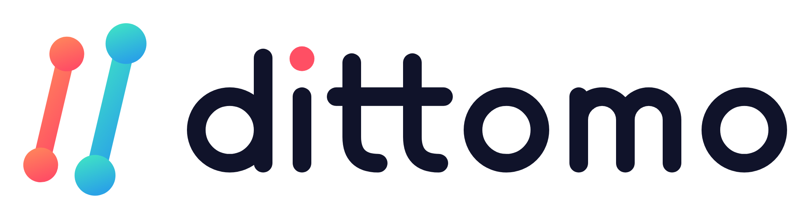

# dittomo brand

**dittomo** is *ditto* and *motion*: the same motion, again, on another body.

## The mark

A ditto sign, 〃, drawn as two bones. The coral bone is the source; the teal one is the copy, leaning the same way but
a size bigger. That's the job: the same motion on a body built differently. The dot on the wordmark's *i* is a joint,
in the source's coral, and the two *t*s share one crossbar.

The wordmark is drawn from strokes, not set in a font, so it looks the same everywhere and needs nothing installed.

## Colour

| | | |
| --- | --- | --- |
| Coral, the source | `#FF8A5B` → `#FF4F64` | the first bone, the *i*'s dot |
| Teal, the copy | `#41E8C3` → `#2AA3E6` | the second bone |
| Night | `#171C3A` → `#0B0E1F` | backgrounds |
| Ink | `#10132A` | the wordmark on light |
| Paper | `#F6F3EC` | the wordmark on dark |

The type on the cards is Segoe UI Variable Display, bold for headlines. The tagline is **One motion. Any body.**

## Files

| File | For |
| --- | --- |
| `dittomo-logo.svg` / `.png` | the lockup on light backgrounds |
| `dittomo-logo-light.svg` / `.png` | the lockup on dark backgrounds |
| `dittomo-mark.svg` | the mark alone, on any background |
| `dittomo-icon.svg`, `-512.png`, `-1024.png` | avatars and app icons: the mark on night |
| `favicon-64.png` | browser tabs |
| `dittomo-wordmark.svg` | the name alone |
| `social-preview.png` | GitHub's social preview (Settings → Social preview), 1280×640 |
| `hero.png` | the README's banner, 1600×640 |
| `demo.gif` | five seconds of a retarget: the source, then dittomo's copy |

`sh assets/brand/build.sh` rebuilds all of them. The logos come from `src/brand.py`, the cards from `src/*.html`, and
the frames the cards show are real retargets, rendered by `examples/video.rs`.

Keep clear space around the mark of at least one joint's width. Don't recolour the bones, set the wordmark in a font,
or put the coloured mark on a busy photo; put the icon there instead.
